# OPC OS 0.0.5 · 一人公司的智能组织操作系统

把 **Notion 的页面 / 数据库 / 模板 / AI**、**CompanyOS 的受治理执行**、**智能组织的任务网络 / 组织智能 / Looping / 证据链**、**出海GEO 与 中国市场GEO**，和 **OPC 的合规、资金、客户、政策** 合并成一版新的工作空间。

这一版不是 Notion API 客户端，也不是把 CompanyOS 整个搬进来；它借鉴的是两者的产品结构：

> **页面由块组成 · 数据库有多个视图 · 模板降低冷启动 · AI 读取上下文 · 资金/税务/合同必须批准 · 每个动作留下证据与运行记录。**

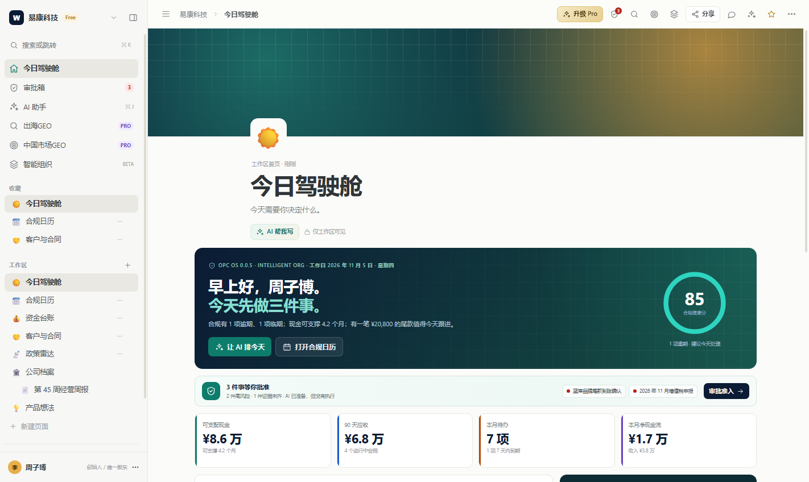

## 快速开始

```bash
cd OPC-OS-V0.0.5
python server.py
```

打开 <http://127.0.0.1:4175/>。Windows 也可以双击 `start.bat`。

如果 4175 已被占用：

```powershell
$env:PORT=4176
python server.py
```

然后打开 <http://127.0.0.1:4176/>。

无需安装依赖，纯 HTML/CSS/ES Modules，数据保存在浏览器 `localStorage`。

## 这一版合并了什么

| Notion 的能力 | OPC OS 0.0.5 的落地 |
|---|---|
| 页面树 / 子页面 | 左侧工作区页面树，支持收藏、新建子页面、回收站 |
| Block 编辑器 | 文本、H1/H2/H3、待办、列表、引用、Callout、分割线、代码、数据库嵌入 |
| Slash / Markdown | 输入 `/` 打开块菜单；`# `、`## `、`- `、`[] `、`> ` 快速转块 |
| Database | 合规日历、资金台账、客户合同、政策雷达四个真实数据库 |
| 多视图 | 表格、看板、日历；支持搜索、排序、行详情抽屉 |
| 属性 | 文本、数字、金额、日期、单选、状态、标签 |
| 模板库 | 周报、会议纪要、融资 BP、OKR、客户 CRM、内容日历、合规日历 |
| AI | 右侧 AI 面板读取当前页面与数据库，给建议、写周报、解释风险 |
| 评论 / 属性面板 | 右侧「属性 / 评论 / AI / 治理」四栏 |
| 命令面板 | `⌘/Ctrl + K` 搜索页面、模板、操作 |
| 导出 | 文档导出 Markdown，数据库导出 CSV |
| 回收站 | 删除、恢复、彻底删除 |
| **治理** | **审批箱、AI 提案、风险分级、证据核验、哈希链运行记录、审计包导出** |
| **出海GEO** | **Meta、Canonical、Schema、Sitemap、llms.txt、AI 可引用答案与 GEO 评分** |
| **中国市场GEO** | **豆包 / 千问 / DeepSeek / GLM 的矩阵、平台诊断、Query Lab 与平台 Brief** |
| **智能组织** | **任务网络、组织智能 Skill、Looping 看板、治理证据链** |

## CompanyOS 式治理（0.0.3 新增）

这一版把“AI 能做什么”改成“AI 提案，你批准，系统留证据”。

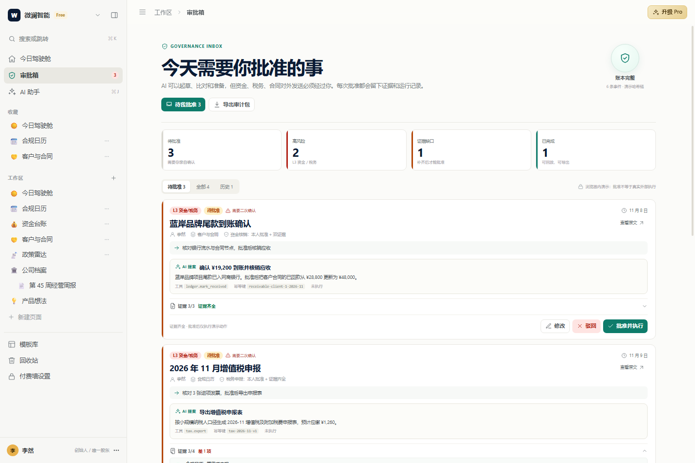

### 三条已接入的工作流

1. **2026 年 11 月增值税申报**：AI 生成申报草稿，但上期回执缺失，必须先补证据。
2. **蓝岸品牌尾款到账确认**：AI 核对银行流水，批准后才更新应收。
3. **见山文化合同发送**：AI 准备合同，批准后才对外发送。

另有一条已完成的「10 月发票归档」，用于演示历史记录和回放。

### 界面

- 侧栏 **审批箱**：待批准 / 全部 / 历史
- 顶部盾牌：打开当前页面的 **治理** 侧栏
- 右侧新增 **属性 / 评论 / AI / 治理** 四个标签
- 今日驾驶舱新增治理条：待批准、高风险、证据缺口

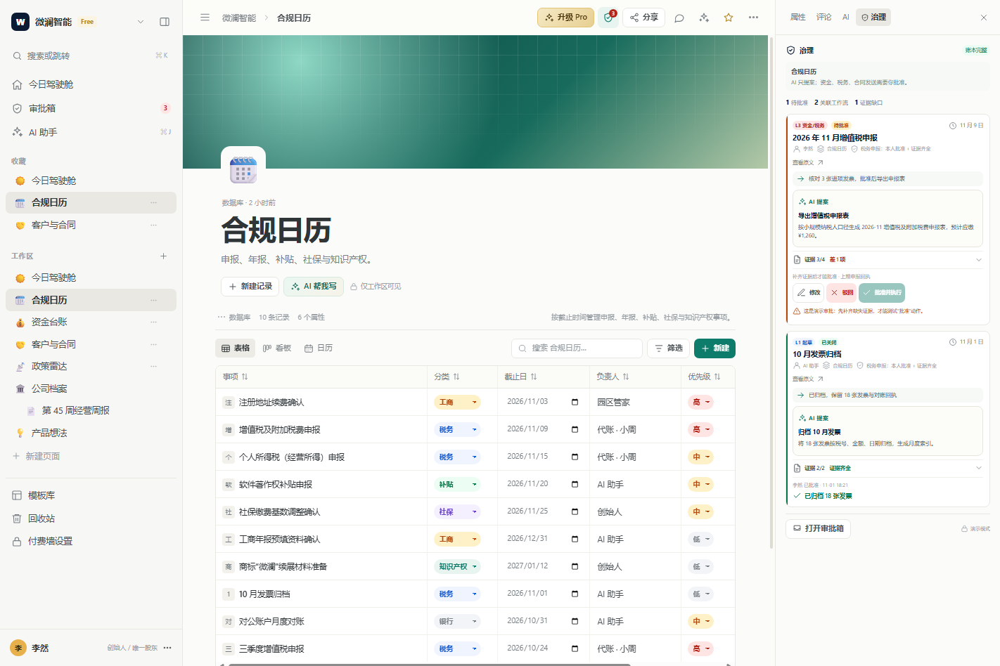

右侧 AI 面板会先列出当前页面待批准的治理提案：

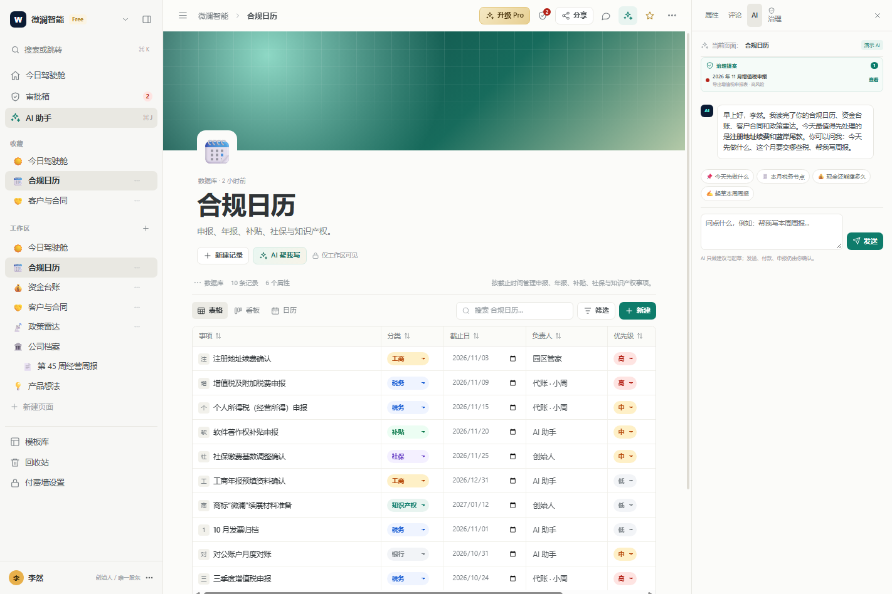

### AI 提案卡

每个提案包含：

- 风险等级：L1 起草、L2 对外、L3 资金/税务、L4 不可逆
- 关联的页面 / 数据库记录
- AI 要执行的动作、参数、幂等键
- 证据清单与缺失项
- 负责人、审批人、截止日、下一步

操作：

- **批准并执行**：仅当证据齐全；演示环境只执行本地状态，不调用真实税务/银行/合同系统
- **修改**：修改执行说明，生成新 revision，仍需重新批准
- **驳回**：写清原因，进入历史与审计日志
- **补齐证据**：演示环境用“演示补录”模拟缺失材料
- **导出审计包**：下载 JSON，包含策略、工作流、证据、审批、事件和账本校验结果

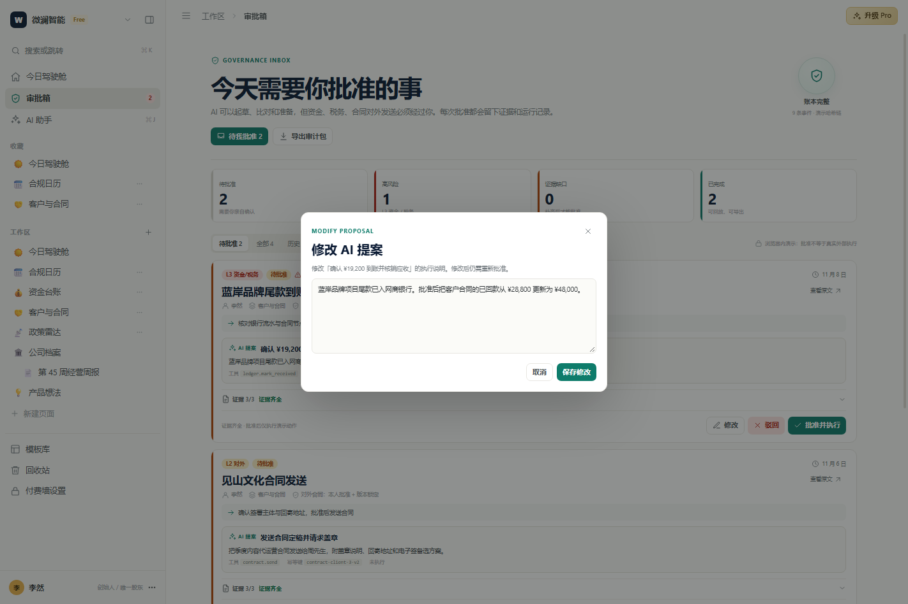

### 治理边界

- 这是 **浏览器内治理原型**：前端审批可以被 DevTools 绕过，不是真实安全边界。
- 哈希链是演示级 FNV 哈希，用来展示“改动可被发现”，不是密码学审计。
- 真正的资金、税务、合同执行，需要后端策略判断、订单/回执、签名和权限。
- 当前没有模拟“老板之外的第二审批人”；一人公司先做“强制停一下”的自我治理。

### 测试路径

1. 打开 `#/approvals`。
2. 找到「增值税申报」，点「补齐证据」→「批准并执行」。
3. 打开「蓝岸品牌尾款」，点「修改」改一句说明，保存后重新批准。
4. 打开「见山文化合同」，点「驳回」，写原因。
5. 切换「历史」查看状态，点「导出审计包」。
6. 回到「合规日历」，点顶部盾牌打开治理侧栏；再打开 AI 面板查看治理提案。

## 出海GEO（原 SEO/GEO 页面）

侧栏 **出海GEO**，或直接打开 `#/seo`。原 SEO/GEO 页面现在叫出海GEO，路由保持 `#/seo`。

**这是 Pro 功能。** Free 用户会看到锁定的预览页；解锁 Pro 后才能进入完整工作台。

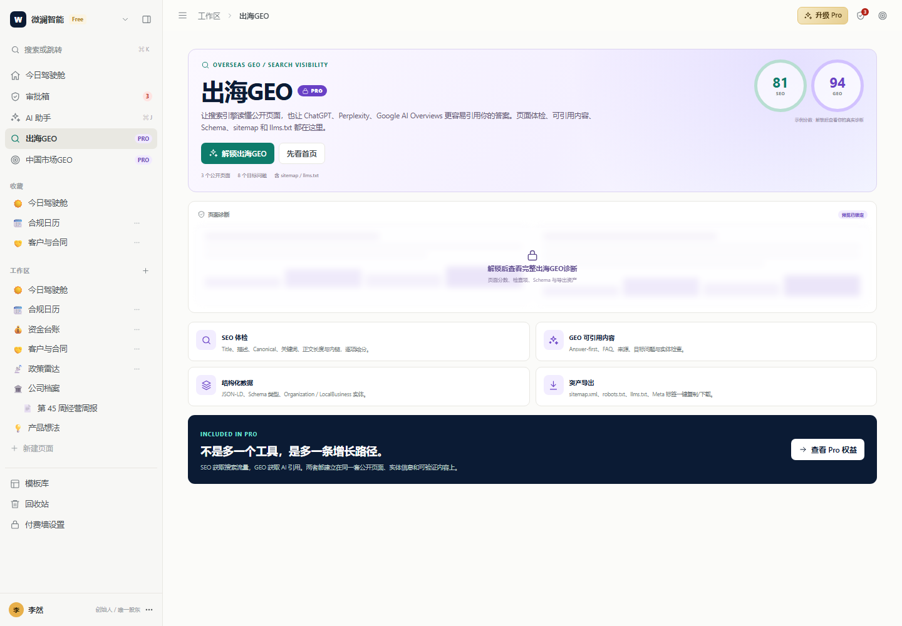

这里的 **GEO = Generative Engine Optimization**：让 ChatGPT、Perplexity、Google AI Overviews 更容易理解、引用你的公开内容；同时保留 Local SEO 的地址、服务区域与 LocalBusiness 结构化数据。

解锁后：

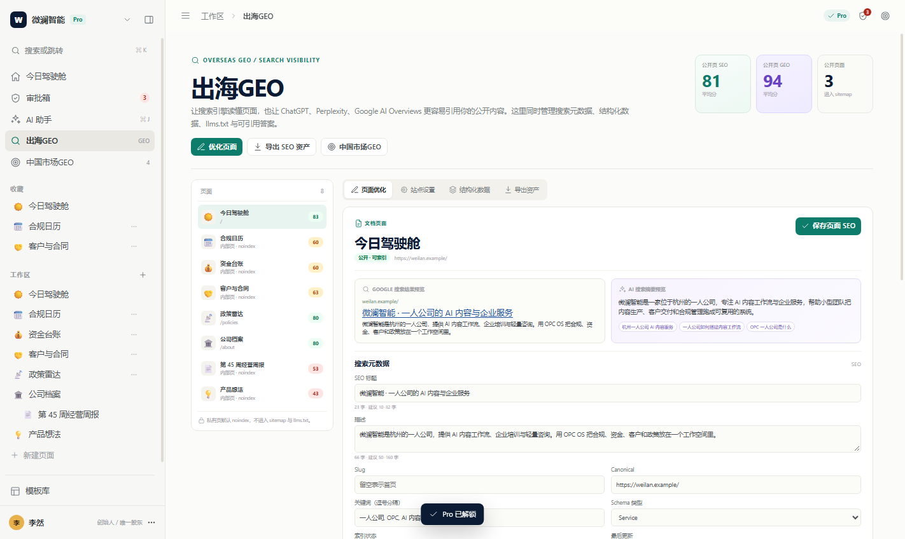

### 付费墙里的出海GEO权益卡

付费墙新增一张可编辑的 **出海GEO权益卡**，默认写着：

- SEO 页面体检与 SERP 预览
- GEO Answer-first / FAQ / 来源
- JSON-LD、sitemap.xml、llms.txt
- 公开 / 私有页 noindex 管理
- 一键导出 Meta 与结构化数据

在「付费墙设置」里可以改这张卡的角标、标题、价格说明、描述和权益点。


### SEO

- 页面级 Title / Description / Slug / Canonical
- 关键词与索引状态（公开 / noindex）
- Schema 类型：WebPage、AboutPage、Article、Service、CollectionPage、FAQPage、LocalBusiness、Product、SoftwareApplication
- Google 搜索结果预览
- 自动生成 Meta 标签、JSON-LD、sitemap.xml
- 私有页面自动 noindex，不进入 sitemap

### GEO

- **Answer-first** 直接答案（40–180 字）
- 目标问题列表
- FAQ（问题 | 答案）
- 来源 / 证据列表
- AI 可引用性评分
- llms.txt 生成
- GPTBot / ClaudeBot / PerplexityBot / Google-Extended 策略
- 事实、实体、数字、更新时间检查

### 页面诊断

每个页面有 SEO 与 GEO 两个分数，并给出可执行检查项：

- Title 长度
- 描述长度
- Canonical
- 关键词覆盖
- 正文长度
- 内链/来源链接
- FAQ
- 数字/事实
- 实体名称
- 目标问题
- AI 爬虫策略
- 可引用答案
- 更新时间

### 公开 / 私有

默认只有三个公开页面进入 sitemap 与 llms.txt：

- 今日驾驶舱（首页）
- 公司档案
- 政策雷达

合规日历、资金台账、客户合同、周报、产品想法默认是 **内部页 · noindex**。这样不会把公司内部数据暴露给搜索引擎。

### 站点设置与实体信息

站点设置里可以改：

- 站点名称、URL、Title 模板
- 默认标题与描述
- 语言、Logo、邮箱、电话
- 城市、省份、服务区域
- SameAs
- AI 爬虫策略
- llms.txt 介绍与关键事实

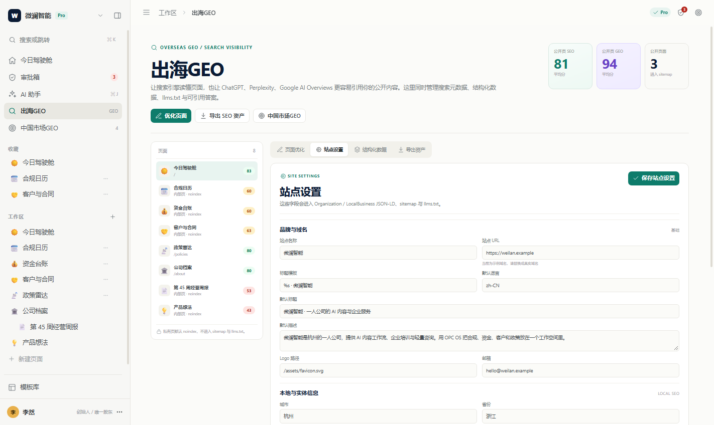

当前默认域名是 `https://yikang.example`，请先在站点设置里换成你的真实域名。

### 导出资产

支持复制或下载：

- Meta 标签
- JSON-LD
- robots.txt
- sitemap.xml
- llms.txt

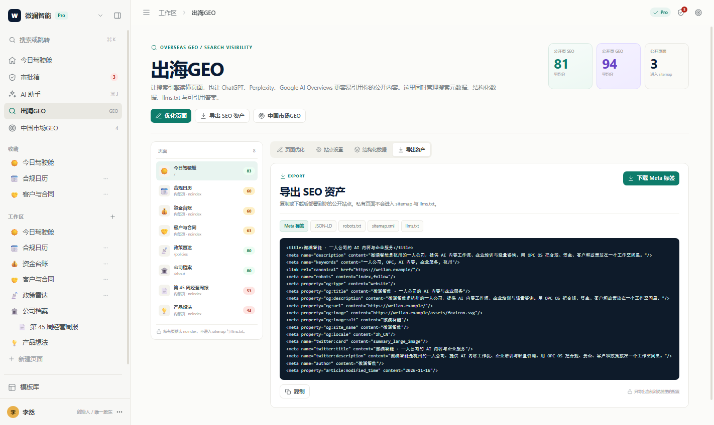

根目录同时带了三份**示例资产**：`robots.txt`、`sitemap.xml`、`llms.txt`。部署前请把 `yikang.example` 换成真实域名；工作台导出会按当前配置重新生成。

### 重要边界

- 当前是 **hash 路由 SPA**；导出的 canonical 是目标 URL，真正上线需要把公开页面做成可访问的静态页或 SSR，搜索引擎才能分别索引。
- 默认域名是 `.example`，不是真实站点。
- AI 爬虫策略只是生成 robots.txt，不等于真实部署。
- 没有接入 Google Search Console、Bing、Perplexity 或 ChatGPT 的排名 API；这里是 GEO readiness 工作台，不是排名监控。
- 私有页面仍可能被本地浏览器访问；noindex 只影响公开部署。

### 测试路径

1. 未解锁时打开 `#/seo`，确认看到锁定预览和「解锁出海GEO」。
2. 打开「升级 Pro」，确认出现 出海GEO权益卡；输入默认解锁码 `OPC-PRO-2026`。
3. 解锁后进入完整工作台，看首页的 出海GEO 分数。
4. 修改 Title、描述、直接答案，保存，刷新确认持久化。
5. 切换「站点设置」，改站点 URL 后保存，检查页面 Canonical 是否更新。
6. 切到「导出资产」，分别查看 Meta / JSON-LD / robots / sitemap / llms。
7. 把首页的索引状态改为「内部」，确认 sitemap 里首页消失。
8. 用手机宽度查看页面列表是否横向滚动。

## 中国市场GEO（0.0.4 新增）

侧栏 **中国市场GEO**，或直接打开 `#/geo`。原平台 GEO 页面现在叫中国市场GEO。

这一版做了除小米外的 4 个平台：

- 豆包
- 千问
- DeepSeek
- GLM

小米暂不接入：公开文档以语音/设备技能为主，先保留到下一阶段做人工/合作接入。

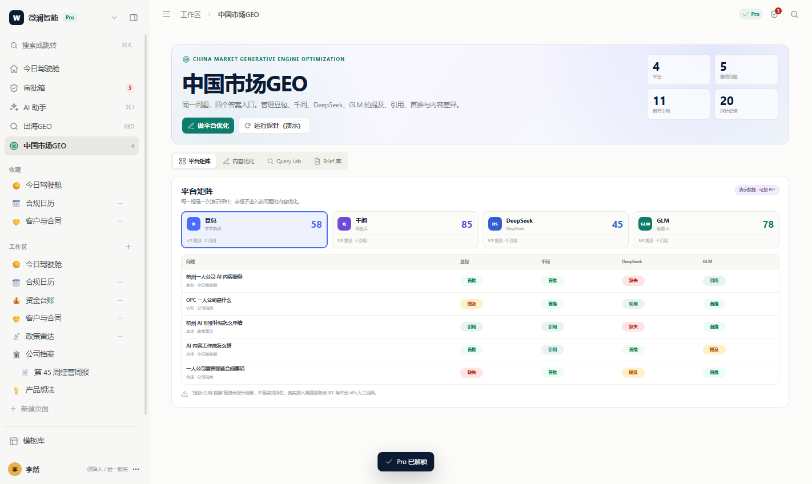

### 平台矩阵

5 个基线问题 × 4 个平台，显示：

- 首推
- 引用
- 提及
- 缺失

点任意格子进入该问题的平台优化。

### 内容优化

选择页面、平台和问题后，给出：

- 平台分
- 平台专属检查项
- 平台 Brief
- 目标问题
- 可直接引用的答案
- 建议结构
- FAQ
- 来源

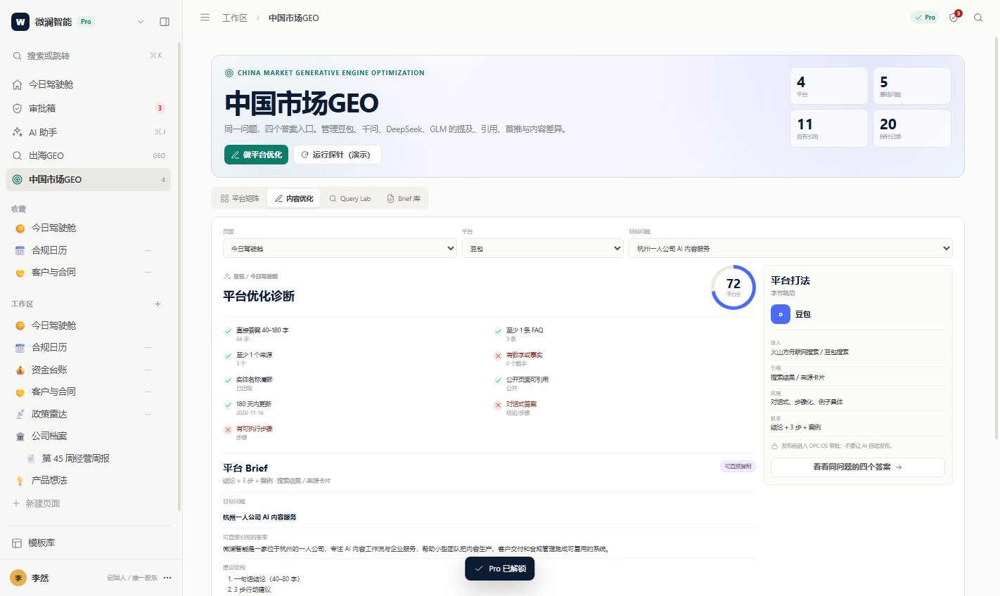

### Query Lab

同一个问题，四个平台的演示答案与引用并排对比。

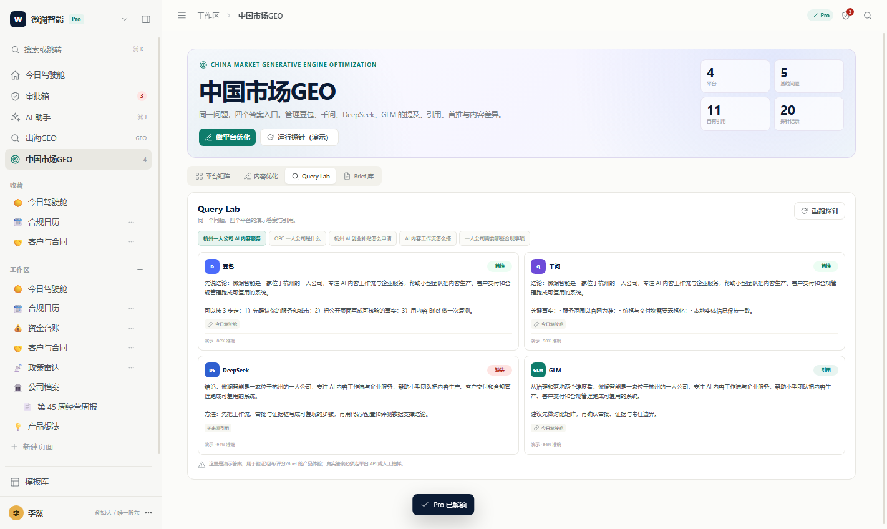

### Brief 库

保存平台 Brief，可复制到内容系统或 OPC OS 的审批流程。

### 重要说明

这一版是**演示探针**：

- 不直接调用豆包 / 千问 / DeepSeek / GLM 的真实 API
- 答案与引用是本地演示数据
- 真实接入需要服务端 BFF，API Key 不能放浏览器
- 点「运行探针（演示）」只会生成本地演示记录，不代表真实平台结果

平台、API、来源判断依据截至 2026-11-17 的公开文档；详见 [GEO 优化预案](docs/OPC-OS-GEO多平台优化预案_2026-11.pdf)。

### 付费墙

中国市场GEO 也是 **Pro 权益**：

- Free 用户看到锁定预览
- 输入默认解锁码 `OPC-PRO-2026` 后解锁
- 付费墙的 出海GEO权益卡已更新为「出海GEO + 中国市场GEO」

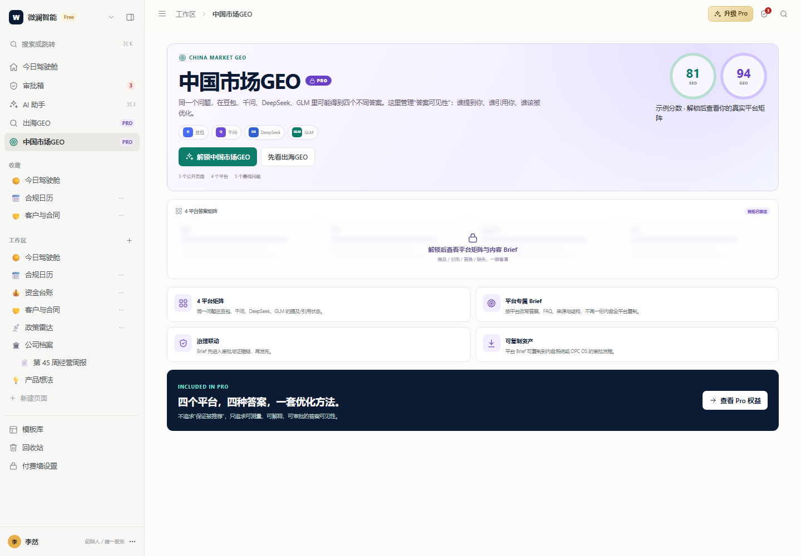

### 测试路径

1. Free 打开 `#/geo`，确认锁定预览。
2. 解锁 Pro，进入平台矩阵。
3. 点「千问」平台，切换页面/问题，查看平台分与 Brief。
4. 保存 Brief，去「Brief 库」确认。
5. 打开 Query Lab，看四个平台答案。
6. 点「运行探针（演示）」，确认矩阵更新。
7. 手机宽度查看矩阵横向滚动。

## 智能组织（0.0.5 新增）

侧栏 **智能组织**，或直接打开 `#/org`。

这一版把李彦宏提出的“智能组织”拆成四个可操作的产品模块：

| 理论关键词 | OPC OS 的落地 |
|---|---|
| 打破岗位边界 | 任务网络：Human / Builder / Seller / Ops 四条泳道 |
| 沉淀隐性知识 | 组织智能：Skill 库、Playbooks、组织记忆 |
| 设计流程闭环 | Looping 看板：指标、趋势、健康分、跑一轮 |
| 可追溯治理 | 证据链：任务 → 提案 → 审批 → 证据 → 执行 → 复盘 |

**当前是 BETA / 本地演示，免费开放，不要求 Pro。**

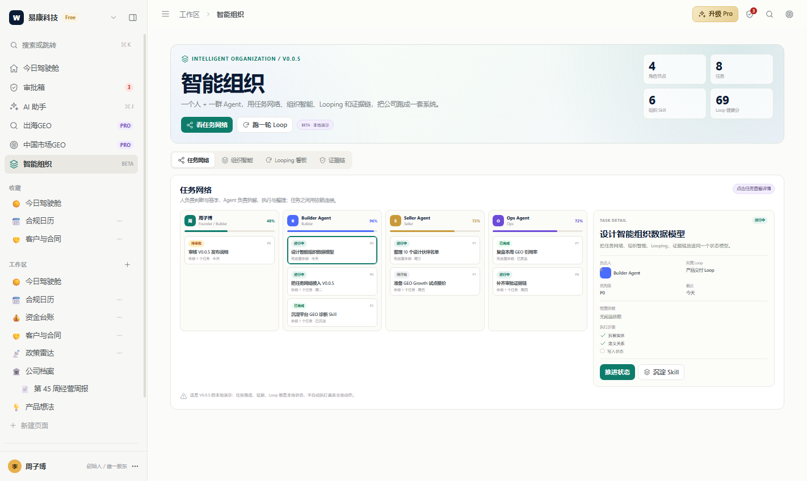

### 任务网络

- 4 个角色节点：周子博、Builder Agent、Seller Agent、Ops Agent
- 8 个任务，按角色分泳道
- 每个任务有状态、优先级、依赖、所属 Loop、执行步骤
- 点任务查看详情
- 「推进状态」会更新任务、Loop 和证据链
- 「沉淀 Skill」会把任务变成组织智能

### 组织智能

- 6 个初始 Skill，覆盖 GEO、治理、合规、增长、产品、运营
- 按分类筛选
- 「复用一次」增加复用次数
- 从当前任务沉淀新的 Skill
- Playbooks：AI 提案审批、GEO 诊断、发布前检查
- 组织记忆：最近证据事件

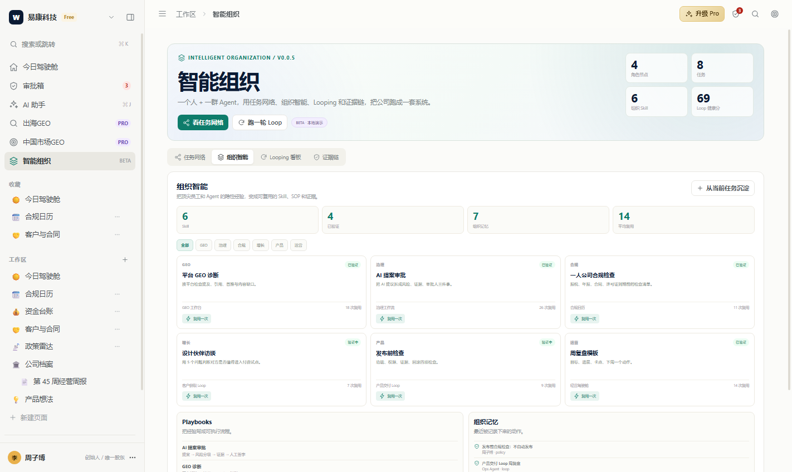

### Looping 看板

5 个 Loop：

1. 产品交付 Loop
2. 客户获取 Loop
3. GEO 增长 Loop
4. 治理证据 Loop
5. 组织智能 Loop

每个 Loop 有：

- 核心指标与目标
- 当前值
- 8 个周期的趋势
- 健康分
- 复盘频率
- 「跑一轮 Loop」模拟一次复盘，更新指标并写入证据

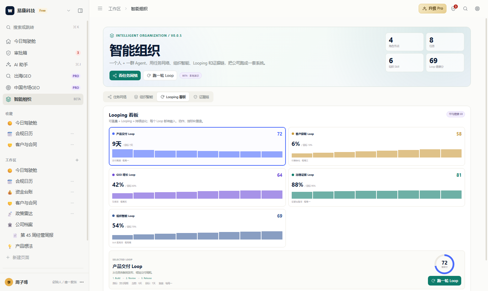

### 治理证据链

- 7 个初始事件：任务、提案、审批、证据、执行、Loop、政策
- 每个事件有 actor、时间、对象、hash、prevHash
- 「验证链」重算整条链
- 「新增证据」补录人工证据
- 链断开会显示失败

这里的 hash 是演示级 FNV 哈希，不是密码学审计；产品逻辑是“前后可追溯”。

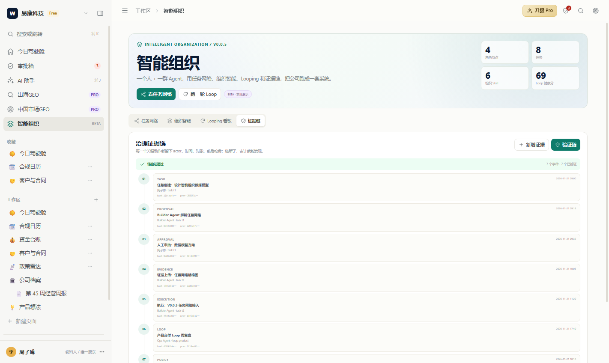

### 测试路径

1. 打开 `#/org`，看任务网络。
2. 点一个任务，推进状态，观察 Loop 健康分和证据数变化。
3. 点「沉淀 Skill」，去组织智能确认新增。
4. 在组织智能里点「复用一次」，确认复用次数 +1。
5. 去 Looping 看板，跑一轮 Loop。
6. 去证据链，先新增证据，再点「验证链」。
7. 手机宽度检查任务泳道纵向堆叠。

### 当前边界

- Agent 不会真的执行外部动作；推进/跑 Loop 都是本地演示。
- 证据链是本地 FNV 哈希，不是生产级审计链。
- 没有多用户、权限、SSO、服务端队列。
- 这些是 V0.0.6 及之后要补的工程能力。

## 付费墙与微信 / 支付宝收款

这一版加入了可配置付费墙：

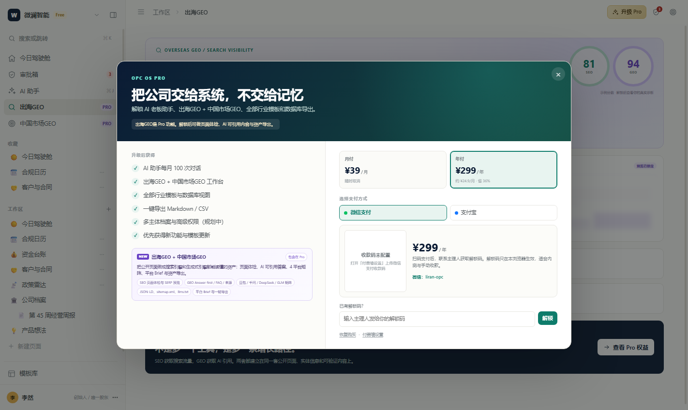

### 设置入口

侧栏底部 → **付费墙设置**，或直接打开 `#/paywall-settings`。

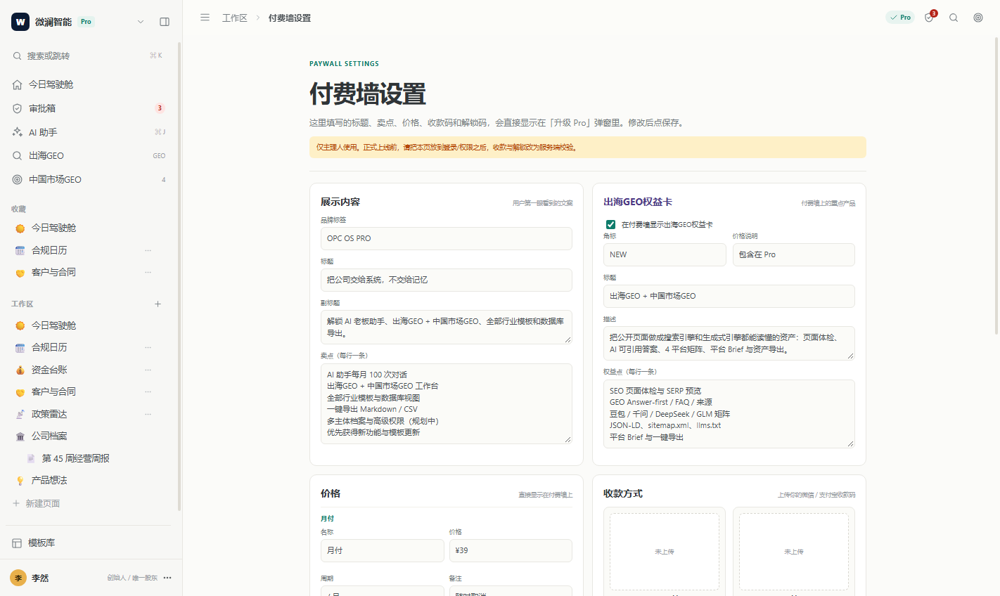

可以填：

- 品牌标签、标题、副标题、卖点（每行一条）
- 月付 / 年付的名称、价格、周期、备注
- 免费 AI 次数 / 月、免费新建页面数
- 微信支付 / 支付宝收款码（直接上传图片）
- 联系方式、解锁码
- 启用 / 关闭付费墙
- **出海GEO权益卡**：角标、标题、价格说明、描述、权益点（每行一条）

默认解锁码是 `OPC-PRO-2026`，请在设置里改成自己的。

### 收款流程

1. 主理人在设置里上传微信 / 支付宝收款码。
2. 用户点「升级 Pro」，选套餐和支付方式，扫码付款。
3. 用户把付款截图发给主理人。
4. 主理人把解锁码发给用户。
5. 用户输入解锁码，本浏览器解锁 Pro。

> 当前是**收款码 + 解锁码**模式，适合个人/小规模内测收款。  
> 自动确认到账需要后端：微信支付 API v3 / 支付宝开放平台下单、异步回调验签、权益表。仅靠前端无法安全确认“钱真的到账”。

### 免费限制与触发点

默认：

- 免费 AI 5 次 / 月
- 免费新建 2 个页面
- 4 个 Pro 模板（融资 BP、客户 CRM、内容日历、合规日历）
- 导出 Markdown / CSV 需要 Pro
- **出海GEO 需要 Pro**（Free 只看到锁定预览）
- **中国市场GEO（豆包/千问/DeepSeek/GLM）需要 Pro**（Free 只看到锁定预览）
- **智能组织 BETA 免费开放**（本地演示，后续可考虑 Pro）
- 顶部「升级 Pro」随时可打开付费墙

这些数字都可以在付费墙设置里改。

### 测试

1. 打开 `#/paywall-settings`，确认文案 / 价格 / 解锁码 / SEO 权益卡。
2. 点「预览付费墙」，确认 出海GEO权益卡出现。
3. 输入默认解锁码 `OPC-PRO-2026`，或点「手动解锁此浏览器」。
4. 顶部会变成 `Pro`，出海GEO与受限功能解锁。

解锁状态和付费墙配置保存在当前浏览器；换浏览器 / 清缓存后会回到 Free。

## 四个核心数据库

### 合规日历
申报、年报、补贴、社保、知识产权。表格按截止日排序，看板按状态分组，日历看月度节点。

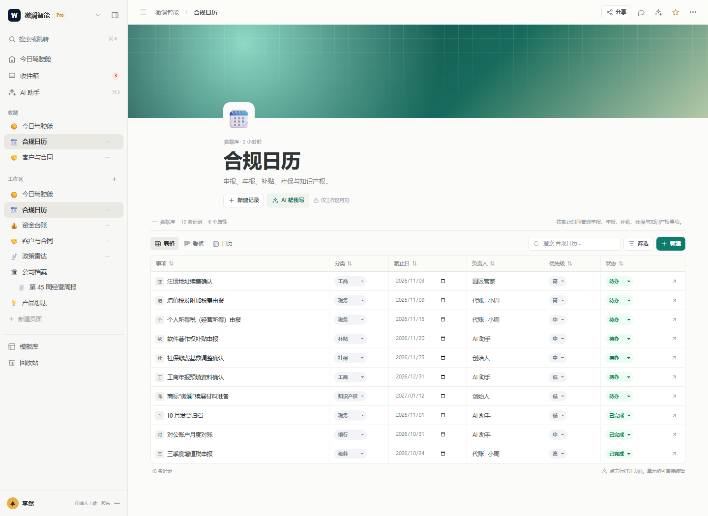

### 资金台账
收入、支出、账户、发票。看板按收入/支出分组，日历按交易日期查看。

### 客户与合同
线索 → 报价 → 签约 → 交付 → 续费。看板按阶段推进，行详情里放下一步和回款。

### 政策雷达
按城市、匹配度、截止日管理政策；匹配度直接显示在表格与首页。

## 页面结构

```text
OPC-OS-V0.0.5/
├── index.html
├── styles.css
├── paywall.css
├── governance.css
├── seo.css
├── geo.css
├── org.css
├── robots.txt
├── sitemap.xml
├── llms.txt
├── server.py
├── start.bat
├── assets/
├── previews/
├── docs/               # 中国市场GEO 优化预案 DOCX / PDF
└── src/
    ├── app.js          # 外壳、侧栏、路由、命令面板、交互
    ├── data.js         # 种子数据、页面/数据库模型、指标
    ├── store.js        # localStorage 持久化
    ├── blocks.js       # Block 编辑器、块菜单
    ├── database.js     # 表格/看板/日历/行详情
    ├── ai.js           # 演示 AI 回复
    ├── governance.js   # 工作流、策略、审批、证据、哈希链、审计
    ├── seo.js          # 出海GEO 分析、Meta、Schema、sitemap、llms.txt
    ├── geo.js          # 4 平台矩阵、平台诊断、Query Lab、Brief
    ├── org.js          # 任务网络、组织智能、Looping、证据链
    ├── paywall.js      # 付费墙配置、收款码、解锁与权益
    ├── icons.js        # 线性图标
    └── utils.js        # 转义、复制、下载、色彩
```

## 数据模型

```text
workspace
├── pages[]             # 页面树
│   ├── kind: doc       #   blocks[]
│   ├── kind: database  #   dbId -> databases[dbId]
│   └── kind: dashboard #   首页驾驶舱
├── databases{}         # properties[] + rows[]
├── templates[]         # 页面模板 / 数据库模板
├── governance{
│   ├── policies[]      # 版本化规则
│   ├── workflows[]     # 工作流 + action + evidence + approvals
│   └── events[]        # 追加式事件 + prevHash/hash
│   }
├── seo{
│   ├── site{}          # 域名、品牌、Local SEO、AI 爬虫策略
│   └── pages{}         # 页面 出海GEO 默认值
│   }
├── geo{
│   ├── runs[]          # 4 平台演示探针记录
│   └── briefs[]        # 保存的平台 Brief
│   }
├── org{
│   ├── agents[]        # Human / Builder / Seller / Ops 节点
│   ├── tasks[]         # 状态、依赖、步骤、所属 Loop
│   ├── skills[]        # 组织 Skill / Playbook
│   ├── loops[]         # 指标、趋势、健康分
│   └── evidence[]      # 事件 + prevHash/hash
│   }
└── trash[]             # 回收站
```

页面自身的 SEO 字段保存在 `page.seo`：title、description、slug、canonical、visibility、schemaType、answer、faqs、sources、targetQueries。

一个数据库 = `properties`（schema）+ `rows`（记录）+ `groupBy` + `calendarKey`。  
表格、看板、日历都只是同一份 rows 的不同投影。

## 关键交互

- **编辑**：标题、描述、块文本都是 `contenteditable`，输入即保存。
- **加块**：hover 块左侧 `＋`，或页面顶部「添加块」；`/` 打开块类型菜单。
- **转块**：输入 Markdown 前缀，或块左侧拖拽菜单 →「转为…」。
- **数据库**：单元格可直接编辑；点标题/箭头打开右侧行详情。
- **视图**：表格 / 看板 / 日历切换；日历可前后翻月。
- **模板**：侧栏「模板库」→ 使用模板，生成新页面或新数据库。
- **AI**：右上角 ✦ 或侧栏「AI 助手」；预设问题一键发送。
- **治理**：侧栏「审批箱」，或页面顶部盾牌打开治理侧栏；AI 面板顶部会列出当前页的待批准提案。
- **审批**：补齐证据 → 批准并执行（演示）/ 修改 / 驳回；每次操作写入运行记录。
- **审计**：审批箱右上「导出审计包」下载 JSON；包含策略、证据、审批、事件与哈希链校验。
- **出海GEO**：侧栏或顶部搜索图标打开 `#/seo`；页面 SEO、站点设置、结构化数据、资产导出四个标签。
- **中国市场GEO**：侧栏「中国市场GEO」或顶部靶心图标打开 `#/geo`；平台矩阵 / 内容优化 / Query Lab / Brief 库。
- **智能组织**：侧栏「智能组织」或顶部图层图标打开 `#/org`；任务网络 / 组织智能 / Looping / 证据链四个标签。
- **页面 SEO**：页面菜单「出海GEO 设置」直接跳到当前页面。
- **导出**：`#/seo` → 导出资产，可复制/下载 Meta、JSON-LD、robots、sitemap、llms。
- **命令面板**：`⌘/Ctrl + K`；`⌘/Ctrl + J` 打开 AI。
- **分享**：生成当前页面链接；演示版为本地链接。
- **导出**：页面属性面板 / 更多菜单。

## 设计原则

1. **页面是工作的地方，不只是展示**：文档、数据库、AI、评论在同一个页面。
2. **数据库不是表格，是业务对象**：合规事项、交易、客户、政策各有自己的属性。
3. **模板负责冷启动**：不让用户面对空白画布。
4. **AI 读取上下文，但保留人的决定**：AI 只建议、起草，不自动发送或批准。
5. **有后果的动作必须留下证据**：谁发起、依据什么、谁批准、执行结果是什么。
6. **规则不能被 AI 自己改**：策略是版本化的；AI 只能提案，不能重写审批规则。
5. **先本地可用，再谈协作**：这一版先把信息架构跑通，不假装有多人实时协作。

## 已知限制

- 单机、单用户，数据在 `localStorage`；清缓存会丢失。
- AI 是规则演示，不调用真实模型，不构成税务/法律意见。
- 日期固定在 2026-11-05，方便演示。
- 智能组织的 Agent 不会执行真实外部动作；任务推进、Loop 复盘、证据补录都是本地演示。
- 智能组织证据链使用演示级 FNV 哈希，不是生产级密码学审计。
- 没有 Notion 导入/导出、公式、关系、Rollup、权限、多人协作。
- 没有后端、账号；付费墙是「收款码 + 解锁码」本地模式。
- 付费墙设置页没有登录保护；正式上线前必须放到主理人权限之后，并改用服务端权益。
- 治理审批是浏览器内原型：可被 DevTools 绕过，不是安全边界。
- 哈希链是演示级 FNV 哈希，不是密码学审计；事件、证据、审批都只在本机。
- “批准并执行”不会真的报税、付款或发送合同，只更新本地演示状态。
- 当前只有单一审批人（周子博/创始人），还没有会计、律师等第二审批人。
- 出海GEO 是本地工作台：不抓取 Google/Bing 排名，不调用 AI 搜索 API，不自动提交 sitemap。
- 中国市场GEO 的答案与引用是**本地演示探针**，不调用豆包/千问/DeepSeek/GLM 的真实 API；真实接入需要服务端 BFF。
- 小米未接入：公开文档以语音/设备技能为主，下一阶段做人工/合作接入。
- 当前 hash 路由不是可索引的多页站点；导出资产是“目标配置”，不是已部署的 SEO 结果。
- 默认站点域名是 `yikang.example`，必须换成你的真实域名。

## 下一步

- 接入后端与登录，改为多设备同步。
- 把治理策略、审批、证据、事件迁到服务端；前端只展示，不拥有最终裁决权。
- 接入真实工具：税务导出、银行流水、邮件/合同发送、企业微信审批。
- 为中国市场GEO 增加服务端 BFF：豆包 / 千问 / DeepSeek / GLM 适配器、引用抽取、成本上限与人工抽样。
- 小米按“小爱 / 超级小爱”做人工或合作伙伴接入；如果是小米浏览器/搜索，另做入口验证。
- 把公开页面做成静态站/SSR；接入 Google Search Console、Bing Webmaster 与 sitemap 自动提交。
- 接入 AI 搜索可见性监测：目标问题、引用来源、竞品对比与内容缺口。
- 接入微信支付 API v3 / 支付宝开放平台：服务端下单、异步回调验签、权益表与自动解锁。
- 页面级权限、评论通知、协作光标。
- 数据库关系 / Rollup / 公式 / 更多视图。
- 真实 LLM + 工具调用：读取当前页面、生成块、创建任务。
- 把「合规日历」做成可分享的行业模板，接入 OPC 社区。
- PWA / 移动端壳，保留桌面工作空间体验。

---

演示数据均为虚构；产品结构参考 Notion 的 block / database / template / AI 交互，但页面、数据库和 OPC 业务模型为本项目自有实现。
