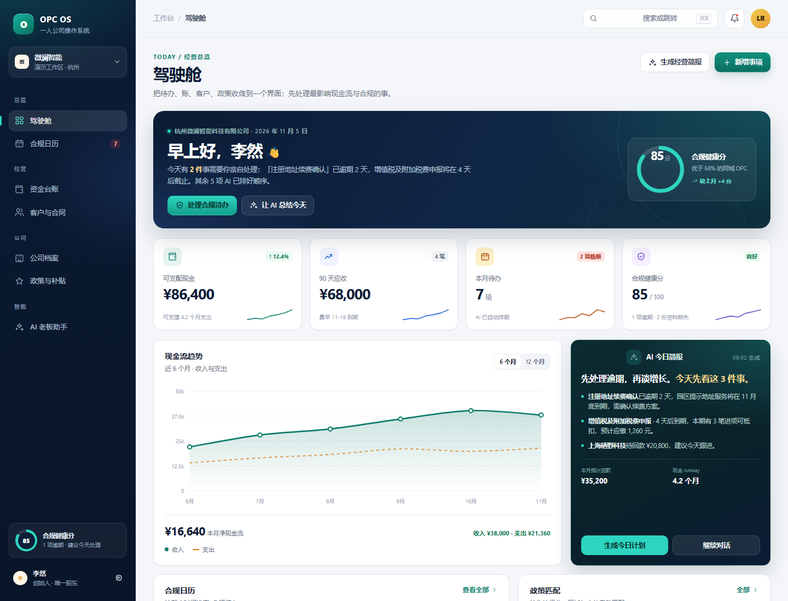

# OPC OS · 一人公司操作系统（演示版）

一个**零依赖、可直接运行**的前端演示工程，把市场研究报告里的“OPC 基础设施”落成一个老板每天愿意打开的驾驶舱：合规、资金、客户、政策与 AI 员工。

> 演示数据均为虚构，日期固定在 2026-11-05。所有修改保存在浏览器 `localStorage`，不会上传。



## 快速开始

```bash
# 项目根目录执行（需要 Node.js 18+）
cd opc-os
node server.mjs

# 打开 http://127.0.0.1:4173
```

也可以使用 `npm run dev` / `npm start`，脚本等价于 `node server.mjs`。

Windows 打包版可直接双击 `start.bat`；脚本会优先使用系统 Node，找不到时回退到 DSH 自带的 Node 运行时。

自定义端口：

```bash
PORT=8080 node server.mjs
```

## 演示什么

| 页面 | 演示点 |
| --- | --- |
| 驾驶舱 | 现金、应收、待办、健康分；现金流趋势；AI 今日简报；合规与政策摘要 |
| 合规日历 | 筛选、搜索、完成事项、健康分实时变化、新增事项、导出 `.ics` |
| 资金台账 | 账户余额、收入/支出图表、待取票、流水筛选、记一笔、导出 CSV |
| 客户与合同 | 销售漏斗、合同进度、回款、客户详情、催款消息 |
| 公司档案 | 主体信息、资料完整度、缺失资料补齐、AI 员工开关、提醒设置 |
| 政策与补贴 | 城市筛选、搜索、匹配度、政策详情、加入合规日历、生成申报清单 |
| AI 老板助手 | 带上下文的问答、快捷问题、打字状态、对话持久化、清空对话 |
| 全局 | `⌘K / Ctrl+K` 快捷命令、通知、响应式侧边栏、Toast、Modal |

建议演示顺序：

1. 驾驶舱点“处理合规待办” → 勾选逾期的“注册地址续费确认”，观察健康分从 85 升到 94、侧边栏提示同步变化。
2. 去“政策与补贴”，把“上城区 OPC 社区场地补贴”加入日历 → 回“合规日历”看新增事项。
3. 去“AI 老板助手”，点“现金还能撑多久？”→ 看它引用现金、应收与 runway。
4. 在“资金台账”记一笔支出 → 账户余额与驾驶舱现金同步更新。
5. 按 `⌘K` 搜索“新增合规事项”或直接跳转页面。

## 工程结构

```text
opc-os/
├── index.html              # 应用外壳：侧边栏、顶栏、挂载点
├── server.mjs              # 零依赖静态服务器（SPA fallback、安全路径校验）
├── package.json
├── styles/
│   ├── tokens.css          # 颜色、圆角、阴影、字体变量
│   ├── base.css            # reset、排版、可访问性
│   ├── layout.css          # 应用骨架、侧边栏、顶栏、响应式
│   ├── components.css      # 按钮、卡片、表格、表单、弹窗、Toast
│   └── pages.css           # 各页面专属布局
├── src/
│   ├── app.js              # 路由、全局事件、Modal、命令面板、导出
│   ├── data.js             # 演示种子数据（公司、任务、流水、客户、政策）
│   ├── store.js            # localStorage 状态与订阅
│   ├── selectors.js        # 派生指标：现金、健康分、应收、runway
│   ├── ui.js               # 格式化、图表 SVG、Toast、Modal
│   ├── icons.js            # 内联 SVG 图标
│   └── pages/              # 7 个页面模块（render + bind）
└── scripts/qa.mjs          # 可选：CDP 无头浏览器截图/交互自检
```

### 设计约定

- **无构建步骤**：原生 ES Modules + CSS，改完刷新即可；方便作为后续接入 React/Vue 之前的交互原型。
- **页面模块接口**：每个页面导出 `{ title, eyebrow, subtitle, render(state), bind(root, ctx) }`；`ctx` 提供 `store / rerender / navigate / toast`。
- **状态单一来源**：`store.state` 只通过 `store.set(mutator)` 修改；订阅后统一重渲染，页面不直接写 DOM 状态。
- **派生指标**：健康分、应收、runway 都在 `selectors.js` 计算，页面只消费结果，方便替换成后端返回值。
- **安全渲染**：用户输入统一经 `esc()` 转义；AI 消息只允许 `**bold**` 与换行两种轻量格式。

## 从演示到生产：建议的下一步

1. **接后端**：把 `data.js` 替换为 `/api/company`、`/api/tasks`、`/api/transactions`、`/api/policies` 四个查询；`store.js` 改成 SWR/TanStack Query 缓存。
2. **接真实合规引擎**：按“城市 × 行业 × 纳税人类型 × 事项”维护规则表，任务由规则生成而非手写；接入电子税务局/银行/电子签的回调。
3. **AI 助手**：把 `replyFor()` 替换为服务端 Agent；上下文注入公司档案、合规日历与资金台账，工具调用落成“创建任务/生成邮件/加入日历”。
4. **权限与审计**：一人公司也会外包给代账/律师，需要“老板 / 代账 / 顾问”三种角色、操作留痕与授权撤回。
5. **多主体**：当前 UI 已预留公司切换器，下一步把 `company` 改成 `companies[]` 并在 store 里维护 `activeCompanyId`。
6. **真实导出**：`.ics`、CSV 已可用；生产环境建议服务端生成 PDF 月报并归档到公司档案。

## 可选：浏览器自检

`scripts/qa.mjs` 用 Chrome DevTools Protocol 打开页面、执行一段 JS 并截图，用于快速回归。

```bash
node scripts/qa.mjs \
  --url "http://127.0.0.1:4173/#/compliance" \
  --out ".preview/compliance.png" \
  --eval "document.querySelector('[data-action=toggle-task]').click()" \
  --wait 900
```

移动端视口：

```bash
node scripts/qa.mjs --url "http://127.0.0.1:4173/#/dashboard" \
  --out ".preview/mobile.png" --width 390 --height 844 --mobile
```

需要本机安装 Chrome 或 Edge；脚本不依赖 npm 包。

## 已知边界

- 这是交互演示，不包含登录、后端、真实支付/申报/开户能力。
- 数据是虚构的；政策金额与截止日仅用于展示匹配与任务联动，不构成申报建议。
- 移动端已做 390px 适配与横向溢出检查，但复杂表格在窄屏下仍以横向滚动呈现。
